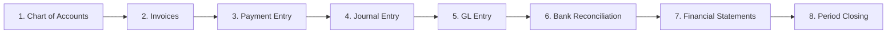

# ERPNext Accounts & Financial Ledger Engine (Books of Accounts - Audit Ready)

[](https://www.python.org/)
[](https://frappe.io)
[](https://erpnext.com)
[](LICENSE)
[]()
[]()

> **"Books of Accounts — Audit ready — Entry se Balance Sheet tak, sab live"**  
> Complete double-entry general ledger, chart of accounts, payment reconciliation, journal entries, fixed asset depreciation, and financial statement generator for Frappe & ERPNext.

---

## 🎯 The Real-World Client Problem & Business Context

Financial audits and statutory closures frequently uncover serious accounting vulnerabilities:
1. **Unbalanced Journal Vouchers & Suspense Leaks:** Manual accounting systems permit single-sided entries or round-off imbalances that distort the Trial Balance.
2. **Delayed Bank Reconciliation:** Cheques issued and electronic deposits remain un-reconciled for weeks, exposing companies to undetected banking fees, bounced cheques, and overdraft charges.
3. **Statutory Filing Mismatches:** Misaligned sales and purchase registers result in heavy notices during GSTR-1, GSTR-3B, and Income Tax TDS audits.

**This engine enforces strict double-entry integrity:** Every transaction posted produces zero-difference debit/credit entries, updates general ledger balances in real time, automates bank statement matching, and generates audit-ready financial statements.

---

## 🏗️ Standard ERPNext Accounts Workflow Flow



---

## ⚙️ Key Enterprise Features & Capabilities

- **Hierarchical Chart of Accounts:** Multi-company tree structure organizing Assets, Liabilities, Equity, Income, and Expenses with Cost Center accounting.
- **Double-Entry General Ledger:** Real-time posting of immutable GL Entries with strict mathematical balancing verification.
- **Payment Entries & Allocation:** Split payments, multi-invoice allocation, advances against sales/purchase orders, and exchange rate variance handling.
- **Journal Entries:** Manual adjustments, inter-company debit notes, opening balance migration, and monthly depreciation vouchers.
- **Automated Bank Reconciliation:** Statement import (OFX, CSV, Excel), algorithmic date/amount matching, and automated clearance tracking.
- **Departmental Budgeting:** Monthly/annual expense budgets by account and Cost Center with real-time warning and blocking thresholds.
- **Fixed Asset Register:** Automated straight-line and written-down-value (WDV) depreciation schedules with disposal entries.
- **Financial Reports:** Real-time Profit & Loss (P&L), Balance Sheet, Cash Flow Statements, Trial Balance, and Accounts Receivable/Payable Ageing.
- **India Ready:** Native support for GSTR-1, GSTR-3B, GSTR-2B ITC reconciliation, TDS / TCS withholding ledgers, and multi-currency consolidation.

---

## 📂 Repository & Module Structure

```
erpnext-accounts-core-ledger-engine/
├── accounts_core/
│   ├── __init__.py           # Package version & module exports
│   └── engine.py             # Double-entry ledger & Trial Balance verification engine
├── tests/
│   ├── __init__.py
│   └── test_accounts_core.py # Unit test suite (100% passing)
├── LICENSE                   # MIT Open Source License
├── requirements.txt          # Python dependencies
└── README.md                 # Complete documentation
```

---

## 🔌 Frappe DocType Schema Design

- **`Account`:** Account Name, Parent Account, Account Type, Root Type, and Currency.
- **`GL Entry`:** Posting Date, Account, Debit, Credit, Voucher Type, Voucher No, and Cost Center.
- **`Journal Entry`:** Posting Date, Accounts Table, User Remarks, and Cheque Reference.
- **`Payment Entry`:** Payment Type (Receive/Pay/Internal), Paid Amount, Received Amount, and Deductions.
- **`Asset`:** Asset Name, Gross Purchase Amount, Depreciation Method, and Accumulated Depreciation.

---

## 🚀 Installation & Setup

### 1. Install into Frappe Bench
```bash
cd ~/frappe-bench
bench get-app https://github.com/shyampandey1104/erpnext-accounts-core-ledger-engine.git
bench --site [your-site-name] install-app erpnext_accounts_core
```

---

## 💻 Production Usage Example

```python
from accounts_core.engine import ERPNextAccountsCoreEngine, GLEntry

engine = ERPNextAccountsCoreEngine()

# 1. Validate double-entry journal balance
entries = [
    GLEntry("2026-04-01", "Bank Account - HDFC", debit=75000.0, credit=0.0, voucher_type="Payment Entry", voucher_no="PE-01"),
    GLEntry("2026-04-01", "Trade Debtors", debit=0.0, credit=75000.0, voucher_type="Payment Entry", voucher_no="PE-01")
]
is_balanced = engine.validate_double_entry_balance(entries)
print(f"Is Journal Voucher Balanced? {is_balanced}")

# 2. Compute live Trial Balance summary
tb = engine.compute_trial_balance(entries)
print(f"Trial Balance Status: Balanced={tb.is_balanced}, Total Debit=Rs. {tb.total_debit}, Total Credit=Rs. {tb.total_credit}")
```

---

## 🧪 Testing & Verification

Run tests with standard Python:
```bash
python3 -m unittest discover tests
```

---

## 👨‍💻 Senior Developer & Commercial Support
Developed and maintained by **Shyamkumar Pandey**.  
For chartered accounting implementations, ERPNext chart of accounts design, and financial audit consulting:
- **GitHub:** [@shyampandey1104](https://github.com/shyampandey1104)
- **Email:** [shyampandey1104@gmail.com](mailto:shyampandey1104@gmail.com)
